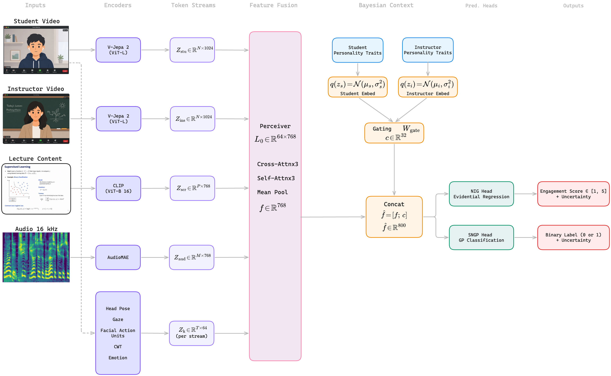

<a href='https://arxiv.org/abs/2608.24340'>Download paper here</a>

We predict student engagement in online tutoring videos by fusing features from pretrained video, audio and image encoders with behavioural cues (head pose, gaze, facial action units, emotion and audio features) in a Perceiver IO model. Learnable person embeddings capture differences between students and instructors, and uncertainty-aware prediction heads give better-calibrated estimates. The work studies why engagement prediction is so hard for new students: people differ a lot, and engagement labels are subjective. Presented at the CASED Grand Challenge at ICMI 2026.

Recommended citation: A. Kantarci, V. Ramesh and G. Roig, "Mind the Student: Behavioral and Contextual Cues for Automated Engagement Prediction in Online Learning," 28th ACM International Conference on Multimodal Interaction (ICMI 2026), Napoli, Italy, 2026.
  
